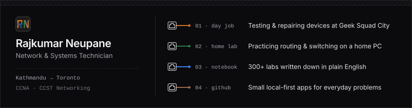

<a href="https://www.rajkumarneupane.com">
  <picture>
    <source media="(prefers-color-scheme: dark)" srcset="./assets/banner-dark.svg" />
    <source media="(prefers-color-scheme: light)" srcset="./assets/banner-light.svg" />
    
  </picture>
</a>

 

Before moving into networking, I learned how to repair dead laptop motherboards in Kathmandu with a multimeter, a soldering iron, and board schematics. Tracing power across circuits taught me to find where things actually fail instead of guessing, and that is still how I approach networks and software today.

<table>
  <tr>
    <td width="50%" valign="top">
      <strong>from the notebook</strong> 
      plain-English notes &amp; labs · <a href="https://www.rajkumarneupane.com/docs">rajkumarneupane.com/docs</a>
      <ul>
        <li><a href="https://www.rajkumarneupane.com/docs">Lab notebook</a> · routing, switching, and server setups tested at home</li>
        <li><a href="https://www.rajkumarneupane.com/blog/proxmox-problems-and-solutions">Proxmox over laptop Wi-Fi</a> · getting a home server online without Ethernet</li>
        <li><a href="https://www.rajkumarneupane.com/blog/ccna-journey">300+ labs in 19 days</a> · how I studied for and passed the CCNA</li>
        <li><a href="https://www.rajkumarneupane.com/blog/computer-repairing-in-nepal">Board repair in Kathmandu</a> · where I got my start in hardware</li>
      </ul>
    </td>
    <td width="50%" valign="top">
      <strong>things I built</strong> 
      small tools made for real problems
      <ul>
        <li><a href="https://github.com/raiz-toff/Comma">Comma</a> · pay tracker for gig workers that keeps all data on your phone</li>
        <li><a href="https://github.com/raiz-toff/immos">Immos</a> · local tool to organize immigration paperwork on your own machine</li>
        <li><a href="https://github.com/raiz-toff/starlight-fumadocs">starlight-fumadocs</a> · clean documentation theme inspired by Fumadocs</li>
        <li><a href="https://github.com/raiz-toff/starlight-glide">starlight-glide</a> · <a href="https://github.com/raiz-toff/jobtracker">jobtracker</a></li>
      </ul>
    </td>
  </tr>
</table>

  <picture>
    <source media="(prefers-color-scheme: dark)" srcset="./assets/network-dark.svg" />
    <source media="(prefers-color-scheme: light)" srcset="./assets/network-light.svg" />
    
  </picture>

  
    <a href="https://www.rajkumarneupane.com">rajkumarneupane.com</a>
    &nbsp;·&nbsp;
    <a href="https://www.linkedin.com/in/rjneupane">linkedin</a>
    &nbsp;·&nbsp;
    <a href="https://www.credly.com/users/rajkumarneupane">credly</a>
    &nbsp;·&nbsp;
    <a href="https://www.rajkumarneupane.com/about">contact</a>
  

