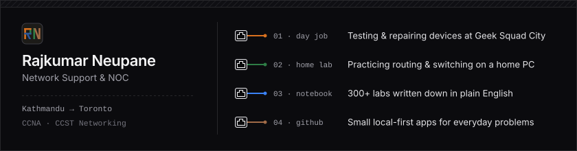

<a href="https://www.rajkumarneupane.com">
  <picture>
    <source media="(prefers-color-scheme: dark)" srcset="./assets/banner-dark.svg" />
    <source media="(prefers-color-scheme: light)" srcset="./assets/banner-light.svg" />
    
  </picture>
</a>

 

Before moving into networking, I learned how to repair dead laptop motherboards in Kathmandu with a multimeter, a soldering iron, and board schematics. Tracing power across circuits taught me to find where things actually fail instead of guessing, and that is still how I approach networks and software today.

  <picture>
    <source media="(prefers-color-scheme: dark)" srcset="./assets/network-dark.svg" />
    <source media="(prefers-color-scheme: light)" srcset="./assets/network-light.svg" />
    
  </picture>

  <a href="https://www.rajkumarneupane.com/docs/ccna-labs"><b>CCNA lab guides</b></a>
  &nbsp;·&nbsp;
  <a href="https://www.rajkumarneupane.com/docs/labs"><b>Home lab write-ups</b></a>
  &nbsp;·&nbsp;
  <a href="https://github.com/raiz-toff/Marrow"><b>Marrow</b></a>: network diagrams compiled from YAML

  
    <a href="https://www.rajkumarneupane.com">rajkumarneupane.com</a>
    &nbsp;·&nbsp;
    <a href="https://www.linkedin.com/in/rjneupane">linkedin</a>
    &nbsp;·&nbsp;
    <a href="https://www.credly.com/users/rajkumarneupane">credly</a>
    &nbsp;·&nbsp;
    <a href="https://www.rajkumarneupane.com/about">contact</a>
  

