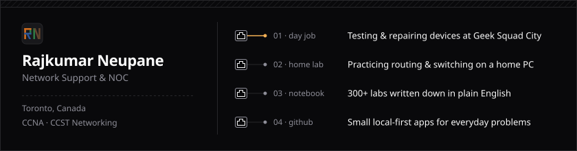
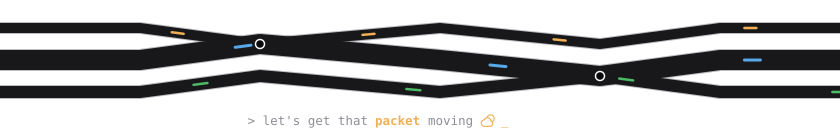
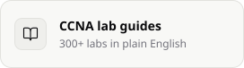

<a href="https://www.rajkumarneupane.com">
  <picture>
    <source media="(prefers-color-scheme: dark)" srcset="./assets/banner-dark.svg" />
    <source media="(prefers-color-scheme: light)" srcset="./assets/banner-light.svg" />
    
  </picture>
</a>

 

Make to break to make to break ............ akhhhh. ••-

Home lab stuff, network tools, and whatever I'm building this month. Poke around, open an issue if something's broken.

  <picture>
    <source media="(prefers-color-scheme: dark)" srcset="./assets/network-dark.svg" />
    <source media="(prefers-color-scheme: light)" srcset="./assets/network-light.svg" />
    
  </picture>

  <a href="https://www.rajkumarneupane.com/docs/ccna-labs"><picture><source media="(prefers-color-scheme: dark)" srcset="./assets/link-ccna-dark.svg" /></picture></a>
  <a href="https://www.rajkumarneupane.com/docs/labs"><picture><source media="(prefers-color-scheme: dark)" srcset="./assets/link-homelab-dark.svg" /></picture></a>
  <a href="https://github.com/raiz-toff/Marrow"><picture><source media="(prefers-color-scheme: dark)" srcset="./assets/link-marrow-dark.svg" /></picture></a>

  <a href="https://www.rajkumarneupane.com"><picture><source media="(prefers-color-scheme: dark)" srcset="./assets/pill-website-dark.svg" /></picture></a>
  <a href="https://www.linkedin.com/in/rjneupane"><picture><source media="(prefers-color-scheme: dark)" srcset="./assets/pill-linkedin-dark.svg" /></picture></a>
  <a href="https://www.credly.com/users/rajkumarneupane"><picture><source media="(prefers-color-scheme: dark)" srcset="./assets/pill-credly-dark.svg" /></picture></a>
  <a href="https://www.rajkumarneupane.com/about"><picture><source media="(prefers-color-scheme: dark)" srcset="./assets/pill-contact-dark.svg" /></picture></a>

